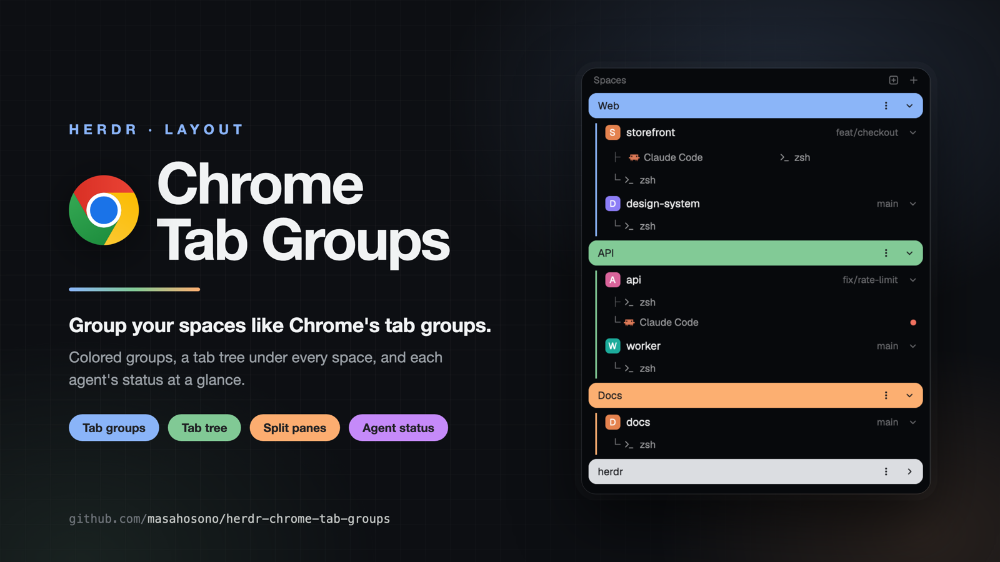

# herdr-chrome-tab-groups

A [Herdr App](https://github.com/herdrdev/herdr-app) layout whose sidebar puts spaces in colored groups like Chrome's tab groups, with a tab tree under each space (split tabs as side-by-side pane pills) and the Agents list.

## Install

Ask your agent in Herdr App to add `github.com/masahosono/herdr-chrome-tab-groups`, or copy by hand:

- `layouts/chrome-tab-groups.json` → `~/.config/herdr-app/layouts/`
- `mods/chrome-tab-groups/` → `~/.config/herdr-app/mods/`

Then switch to it with `layout.switch` (Cmd+Shift+L on macOS).

Before installing: the `chrome-tab-groups` mod runs `git` and `sh`, and stores its groups in `~/.config/herdr-chrome-tab-groups.json`.

See [RECIPE.md](RECIPE.md) for what it does and how it's built.

## License

MIT. See [LICENSE](LICENSE).
