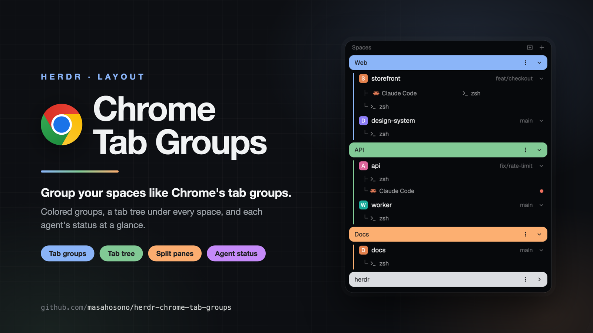

# Chrome Tab Groups

A Herdr App window whose sidebar groups spaces the way Chrome groups tabs. Spaces sit in colored groups: each group's header is a rounded pill in a light tint of its color with dark text, and its spaces hang off a vertical line in the same color. As in Chrome, a group shows up where its first space is. Under each space, a tree lists its tabs, one row each: a tab's pane, or a split tab's panes side by side as pills, so you can jump straight to any agent. Below the spaces is the shipped Agents list. On the right are slim tabs, framed panes and a status bar.

## What you see

Left to right, with a 1px `border` divider between them; the window background is `canvas`; no title bar; traffic lights at (12, 16):

- **Sidebar** (268px, min 44, max 480, `chrome` background; its edge can't be dragged), top to bottom:
  - **Top bar** (46px, drags the window): on macOS it leaves 76px for the traffic lights. Nothing on the left (no Herdr logo). On the right are two 26px ghost buttons with 15px icons: search (opens the `picker` mod) and sidebar (folds the sidebar to a rail and back).
  - **Lists** (separated by 1px `border` dividers):
    - **Spaces** (weight 1, min 120): a 31px header ("Spaces" in 11.5px `dim`, plus a group-plus button for a new group and a plus button for a new space). Below it, the scrolling list (8px side padding):
      - **Group header**: a 30px pill with 10px radius, filled with the group color (grey `#dadce0`, cyan `#78d9ec`, orange `#fcad70`, blue `#8ab4f8`, purple `#c58af9`, green `#81c995`, pink `#ff8bcb`) and text in `#202124`. It shows the group's name (semibold). A folded group still shows a spinner if any of its spaces is working, or a 7px dot in the status color if one is blocked or done. On the right are a `⋮` button (the group's menu) and a chevron (down when open, right when folded).
      - **Group body**: its spaces, indented 8px, hanging off a 2px vertical line in the group color.
      - **Space row** (30px, 28px for a worktree; 8px radius): an 18px tile with 5px radius in the space's color (`#22a99a`, `#e3814f`, `#5b8def`, `#8b7cf6`, `#3fae6a`, `#d9649a`, assigned round-robin), holding the name's first letter in bold white. Then the name (max 150px), then on the right in 11.5px `dim`: the repo name (unless the name already says it), `·`, the branch (main / master are shown too), `↑n` in `ansi2` and `↓n` in `ansi1`. Last comes a chevron that opens and closes the tab tree. The active space gets the `selected` background.
      - **Worktree spaces** sit under their main checkout's space, with a branch icon and `├─` / `└─` indentation.
      - **Tab rows**, one per tab in tab order, as a browser's tab strip shows them. A tab with one pane is a 24px row (12px text): `├` / `└`, the program's icon (13px), then the agent's or shell's name (else the pane title). The focused pane in the active tab gets the `hover` background. No pane counts and no tab names are shown.
      - **Split tab rows** (30px), for a tab with two or more panes, like a browser's split view: `├` / `└`, then one pill per pane side by side, sharing the width (24px, 7px radius, no fill except `selected` for the focused pane in the active tab, `hover` on hover). Each pill holds the program's icon (13px), the agent's or shell's name (truncated), the status mark and an 18px close button (`×`), shown only on the focused pane in the active tab and on the pill under the pointer (left out otherwise, so the name gets the room).
      - Tab rows and pills end with the status mark: a spinner in `working`, a 7px dot in `blocked` or `done`.
      - With more than one machine, each machine gets a 26px header (monitor or server icon, name, group-plus, `+`, a connection dot, a chevron).
    - **Agents** (weight 1, min 90): Herdr's shipped `agents` mod.
  - **Footer** (69px, 1px `border` top): "Settings" (with a 6px `accent` dot when an app update is ready) and "Add machine" (`dim`), each a 28px row with a 14px icon.
- **Work area**, top to bottom:
  - **Tabs** (42px, drags the window): Herdr's shipped `tabs` mod.
  - **Body** (8px padding, 8px gap): the active tab's panes as cards (10px radius, 8px gap, 1px `border`, 1px `accent` when focused, `background` fill, a 30px `pane` header always shown on top, a lone pane is framed too; terminal padding 14 × 12). On the right is a hidden **panel** (368px, min 280, max 900) that stacks the shipped `files` and `changes` mods (`files` active).
  - **Status bar** (28px): Herdr's shipped `workspace-status` mod.

## How it behaves

- **Agent status**: working shows an 11px spinner (900ms per turn) in `working`, blocked a 7px dot in `blocked`, done a 7px dot in `done`, and idle shows nothing. The marks appear on tab rows and pills, and on a group's header while it is folded.
- **Space row click**: selects the space and opens or closes its tab tree. Closed trees stay closed after a restart.
- **Tab row or pill click**: switches to its space, selects the tab (`tab.select`) and focuses the pane (`pane.focus`). A pill's `×` closes that pane (`pane.close`).
- **Space right-click** opens a 230px popup that replaces Herdr's own space menu. It has "Add to new group", "Move to <group>" (with a dot in the group's color) for every other group, and "Remove from group" when the space is in one. After a separator come Rename, New worktree / Open worktree (in a git checkout), Remove worktree (in a linked worktree), and after another separator, Close.
- **Group header**: a click folds or unfolds it. An unnamed group shows only its color.
- **Group menu** (250px popup, like a Chrome tab group's): a right-click or `⋮` opens it. On top, a name field (focused, accent border, placeholder "Name this group") renames the group as you type; Enter closes it. Below, 7 color dots (grey plus the six colors), the current one ringed; a click recolors the group. Then "Ungroup" (the group goes, its spaces stay).
- **New groups**: "Add to new group" on a space, or the group-plus button, makes an unnamed group at once in the least used color and opens its menu. A space joins a group only by drag or the right-click menu.
- **Dragging a space**: a space row and its tab tree count as one. Over the upper half of the space row, a 2px `accent` line shows above it; anywhere below that (its lower half or its tab rows), the line shows below the whole tree, never between a space and its tabs. Dropping there moves the space before or after that space and into its group. Dropping it on a group header (outlined in `accent`) puts it in that group. Below the last row (the empty room under the list, at least 24px), the line shows at the end of the list, and dropping there takes the space out of its group and moves it after the last space of its machine.
- **Dragging a group header**: a line appears between blocks (a whole group, or a space outside any group with its worktrees): before the block when the pointer is in its first half row, after it otherwise. Dropping there moves all of the group's spaces together with `space.move`. Wherever the drop is released, it lands where the line last showed. Releasing outside the Spaces block cancels it.
- **Narrow sidebar** (under 160px): spaces become numbered compact rows with a status glyph, and groups become 18px tiles in their color.

## Built from

- **Layout** `layouts/chrome-tab-groups.json`, cloned from the shipped `main` (0.1.11): `root` row → `sidebar` column [`brand` block (`chrome-tab-groups`, props `{ view: "bar" }`), `sidebar-lists` column [`spaces` (`chrome-tab-groups`), `agents`], `sidebar-footer` (`chrome-tab-groups`, props `{ view: "footer" }`)] and `work` column [`tabs`, `work-body` row [`main` (`tab: active` with pane cards), `panel` column [`panel-body` stack [`files`, `changes`]]], `status` (`workspace-status`)].
- **Mod in this repo**: `chrome-tab-groups` (MIT, with its own SVG icons in `icons/`). `props.view` picks what each copy draws: `bar` is the top bar without the logo, `footer` is the footer, and the default `list` is the Spaces list; its popups (`space-menu`, `group-menu`) are more views of the same mod.
  - The top bar and footer call `run("mod.open", { name: "picker" })`, `run("app.settings")`, `run("mod.open", { name: "machine-add" })` and `run("layout.resize", { id: "sidebar", px })`, and keep `sidebar.width` / `sidebar.collapsed` in shared state.
  - The Spaces list uses `spaces`, `panes`, `machines`, `run` (`space.select`, `space.new`, `space.move`, `space.rename`, `space.close`, `tab.select`, `pane.focus`, `pane.close`), `openOverlay` / `closeOverlay` (its own popups, and the shipped `worktree` dialogs), `exec` (`git`, `sh`), `hc(["machine", "ls", "--json"])`, `watchFolder`, and shared state `chrome-tab-groups.groups` and `space.colors`.
- **Shipped mods used**: `agents`, `tabs`, `pane`, `files`, `changes`, `workspace-status`, `picker`, `machine-add` and `worktree`.
- **Programs run**: `git` (status, rev-parse) in each space's directory, and `sh` to read and write the group file. Both also run on connected remote machines.

## Watch out

- **Files outside its own directory**: `chrome-tab-groups` keeps groups in `~/.config/herdr-chrome-tab-groups.json` on each machine (`{ list, of, at }`) and in the shared state `chrome-tab-groups.groups`. It writes the file atomically (`.tmp` then `mv`), re-reads it every 15s, keeps whichever side has the newer `at`, and writes shared groups back when they are newer.
- A popup closes on any click outside and doesn't tell the mod. So the group name field updates only the shared state on each keystroke, and the file is written on Enter or by the 15s write-back; writing on close would lose the name.
- Closed tab trees are kept in the app's `localStorage` under `spaces.shut`.
- `chrome-tab-groups` takes the place of the shipped `spaces` and `workspace-chrome` mods in this layout. If you rename it, change its directory, the `mod` in the layout, and `MOD` and `ICON` in `main.js`.
- A drop is the list's, not the row's: `on_mouse_up` on the list calls `finishDrag`, so a release anywhere over the list lands where the line shows. A release outside the block is never heard, so the next press there forgets the drag.
- Groups are placed by their first space in Herdr's own order (empty groups go last). Moving a group means moving its spaces with one `space.move` per space, top down.
- A mod directory must be a real directory, not a symlink, or its SVGs don't load. Symlinking the files one by one works.
- Not tested on Linux or Windows. The narrow rail on macOS hides the sidebar button behind the traffic lights; the Agents list's `»` unfolds it.

## Done when

- The sidebar shows Spaces and Agents, top to bottom, and the top bar has only the search and sidebar buttons.
- "Add to new group" on a space adds a tinted pill header with the space under a colored line and opens the group menu; typing a name there shows it on the header at once, and `~/.config/herdr-chrome-tab-groups.json` lists the group.
- Picking a color dot in the group's menu changes both the pill and the line color.
- Dragging the group header below a space outside the group moves all of its spaces after that space in Herdr's order.
- Clicking a space row selects it and folds its tab tree. Clicking a tab row focuses that pane. A tab split in two shows as one row of two pills, and a pill's `×` closes its pane.
- An agent that starts working shows a spinner on its tab row or pill, and on its folded group's header.
